<p align="center">
  
</p>

<p align="center">
  
</p>

<p align="center">
  <a href="https://www.wadakatu.dev"></a>
  <a href="https://twitter.com/koyolympus"></a>
  <a href="https://zenn.dev/wadakatu"></a>
  <a href="https://qiita.com/wadakatu"></a>
  <a href="https://www.linkedin.com/in/koyo-isono-3a821a217/"></a>
</p>

```console
neo@zion:~$ whoami
wadakatu  // Koyo Isono — Backend Engineer, Osaka, Japan 🇯🇵

neo@zion:~$ cat ./profile.yml
role:       Backend Engineer @ Studio Inc. (2024.11 - now) — no-code website builder
experience: 6+ years shipping production backends (since 2020)
focus:      Laravel ecosystem OSS / API docs / AI agent tooling
stack:      [PHP, Laravel, TypeScript, Vue, MySQL, Docker, GCP, AWS]
site:       https://www.wadakatu.dev
award:      🏆 W3C TPAC 2025 Hackathon — Winner
offline:    📷 photographer, ⌨️ HHKB lover
fun_fact:   30+ allergies, still debugging production happily

neo@zion:~$ ls ~/oss --sort=love
```

| `PROGRAM` | `DESCRIPTION` |
| :-- | :-- |
| [**laravel-spectrum**](https://github.com/wadakatu/laravel-spectrum) | Zero-annotation API documentation generator for Laravel / Lumen |
| [**gitlyte**](https://github.com/wadakatu/gitlyte) | Turn your GitHub repo into a live website with AI-powered design |
| [**screenbook**](https://github.com/wadakatu/screenbook) | Screen catalog & navigation graph generator with impact analysis |
| [**lenqo**](https://github.com/wadakatu/lenqo) | Local-first visual review for Playwright captures and live previews |
| [**agent-home-migrate**](https://github.com/wadakatu/agent-home-migrate) | Safely migrate local Codex / Claude Code state between machines |
| [**tombo**](https://github.com/wadakatu/tombo) | Single-file, zero-dependency CSS design system — すべてを測る |

<details>
<summary><code>neo@zion:~$ cat ./upstream.log</code> — contributions to other codebases</summary>
<br>

- [workos/workos-php](https://github.com/workos/workos-php) — Official WorkOS PHP SDK (Guzzle 8 timeout handling, 2026-10)
- [Laravel-Lang](https://github.com/Laravel-Lang) — organization member, 30+ merged PRs
- [php/doc-ja](https://github.com/php/doc-ja) — Japanese translation of the PHP documentation

</details>

```console
neo@zion:~$ tail -n 3 ~/transmissions.log
```

- 📡 [TPAC 2025 Kobe Hackathonでソロ参加し、1位になった話](https://zenn.dev/studio/articles/34829072a95ad8) — Zenn, 2026-01
- 📡 [W3C TPAC 2025参加レポ（Web標準ってどうやってできてるの？）](https://zenn.dev/studio/articles/da5be52d57e9a1) — Zenn, 2025-12
- 📡 [🚀 Claude Code × Serena MCP：もうバージョンダウンしなくても良いのか...?](https://zenn.dev/studio/articles/431afa748fbed1) — Zenn, 2025-07 · ❤️ 334

<h3 align="center"><code>[ LOADING CONSTRUCT... ]</code></h3>

<p align="center">
  
</p>

<h3 align="center"><code>[ SYSTEM TELEMETRY ]</code></h3>

<p align="center">
  
  
</p>

<p align="center">
  
</p>

<p align="center"><code>// There is no spoon. 🥄</code></p>
